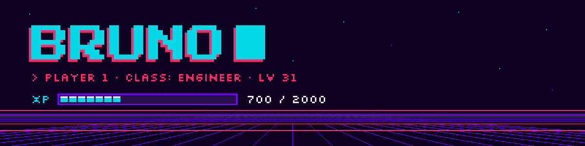

  

  I like building things. 
  Porto Alegre, Brazil.

  
  

---

### 🗺️ Active quests

| | Quest | What it does |
|:-:|---|---|
|  | [**Subquest**](https://github.com/brunocmattos/subquest) | Your Claude Code subagents as a pixel-art RPG party in a live pane. Heroes by model, monsters by tool, a boss per wave. Zero tokens. |
| 🃏 | [**mtg-brain**](https://github.com/brunocmattos/mtg-brain) | A local brain for Magic: The Gathering: every card and combo, an API, a React app, hybrid semantic search and an MCP server. Runs at US$ 0. |

  

### 🎒 Inventory

  
  
  
  
  
  
  
  
  
  
  
  

### 📊 Player stats

  
  

---

🇧🇷 Em português

 

Oi, eu sou o Bruno. Gosto de construir coisas. Porto Alegre, Brasil.

- **[Subquest](https://github.com/brunocmattos/subquest):** os subagentes do Claude Code viram um grupo de RPG em pixel art, num painel ao vivo. Herói pelo modelo, monstro pela ferramenta, um chefe por leva. Zero tokens.
- **[mtg-brain](https://github.com/brunocmattos/mtg-brain):** um "cérebro" local de Magic: The Gathering, com todas as cartas e combos, API, app React, busca semântica e servidor MCP. Custa US$ 0.

⭐ If one of these made your day better, a star on <a href="https://github.com/brunocmattos/subquest">Subquest</a> helps other devs find it.

